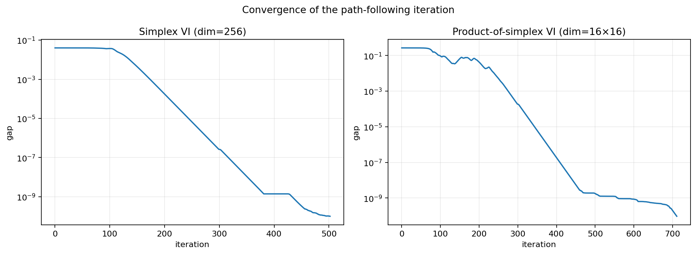
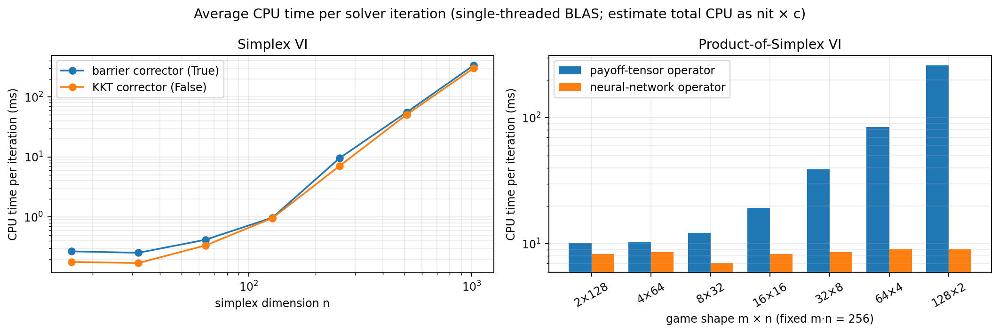

# Fixed-Point Bundle Method for Variational Inequalities and Game Equilibria

[](https://arxiv.org/abs/2606.00778)
[](https://arxiv.org/abs/2609.16158)
[](https://colab.research.google.com/github/shb20tsinghua/FiberBundle_VI/blob/main/examples/quickstart.ipynb)
[](LICENSE)

Reference implementation of the *fixed-point bundle* predictor–corrector path-following method for

- variational inequalities on the simplex, $\mathrm{VI}(F,\Delta_n)$, and
- variational inequalities on the product of simplices, $\mathrm{VI}(F,\Delta_n^m)$, which include the Nash equilibrium problem of $m$-player $n$-action general-sum games.

Both cases are handled by `FP_VI` in `solver/fpvi_numpy.py`: the simplex case $\mathrm{VI}(F,\Delta_n)$ is the special case $m = 1$ of $\mathrm{VI}(F,\Delta_n^m)$. The method requires no monotonicity or other structural assumptions: it performs path-following on a fiber bundle from an arbitrary starting point, detects and avoids singularities, and guarantees global linear convergence.

The solver accepts any object exposing the method `value_Jaco(x) -> (F, JF)`, where `F` is the operator value and `JF` its Jacobian at `x`.
`builtin_model.py` also provides `DerivFreeWrapper`, which turns an object exposing only `value(x) -> F` into a `value_Jaco` operator using a Broyden rank-one Jacobian approximation; this enables the derivative-free mode.

The repository reports 36,000 highly nonlinear instances, covering derivative-free and derivative-based; the gap tolerance `1e-5` is reached on every instance.



*Convergence of two representative runs; reproducible with `python docs/plot_overview.py`.*

**Contents:** [Overview](#overview) · [Installation](#installation) · [Quick start](#quick-start) · [Repository structure](#repository-structure) · [Solver API](#solver-api) · [Built-in operator models](#built-in-operator-models) · [Custom operators](#custom-operators) · [Numerical experiments](#numerical-experiments) · [Cost per iteration](#cost-per-iteration) · [Data](#data) · [Release notes](#release-notes) · [Citation](#citation) · [License](#license)

Python ≥ 3.9 · NumPy ≥ 2.2 · SciPy ≥ 1.10 · MIT License

## Overview

The repository accompanies two papers:

| #   | Paper                                                                                                                                                                                                                | Implementation                                                                    |
| --- | ------------------------------------------------------------------------------------------------------------------------------------------------------------------------------------------------------------------------ | --------------------------------------------------------------------------------- |
| 1   | *A path-following framework on fiber bundle for variational inequalities* — [arXiv:2606.00778](https://arxiv.org/abs/2606.00778), [Optimization Online](https://optimization-online.org/?p=34972)                    | `solver/fpvi_numpy.py` — class `FP_VI`, simplex case $m = 1$                     |
| 2   | *The fixed-point bundle method over product-of-simplex domains arising from game equilibria* — [arXiv:2609.16158](https://arxiv.org/abs/2609.16158), [Optimization Online](https://optimization-online.org/?p=36751) | `solver/fpvi_numpy.py` — class `FP_VI`, product-of-simplices case $m \ge 1$     |

The repository contains the unified solver, the two built-in operator models used to generate random test instances, the derivative-free Jacobian wrapper, the experiment driver, the full per-instance logs behind the tables below, and per-iteration cost measurements.

## Installation

```bash
git clone https://github.com/shb20tsinghua/FiberBundle_VI.git
cd FiberBundle_VI

python -m venv .venv
.venv\Scripts\activate        # Windows
# source .venv/bin/activate   # Linux / macOS

pip install -r requirements.txt
```

Requirements:

- Python ≥ 3.9 (tested with Python 3.14)
- NumPy ≥ 2.2 (`np.vecdot` and `np.matvec` are used in `solver/fpvi_numpy.py`)
- SciPy ≥ 1.10 (`scipy.linalg.lu_factor`, `scipy.linalg.lu_solve`, `scipy.optimize.brentq`)

No GPU is needed; the solver is pure NumPy/SciPy. Only the development helper `docs/plot_overview.py` additionally needs matplotlib.

## Quick start

### Try the Colab notebook without installation

A self-contained Colab notebook builds one operator on $\Delta_n^m$ with arbitrary `m, n`, solves it with the solver `FP_VI`, and plots the convergence trace.
It can use the custom operator or the built-in models, optionally behind the derivative-free wrapper.

[](https://colab.research.google.com/github/shb20tsinghua/FiberBundle_VI/blob/main/examples/quickstart.ipynb)

### From the command line

```bash
python main.py
```

This solves the demo instance — a payoff-tensor game with `m = n = 16` and `R = 256`, seed `0`, barrier corrector, `gap_tol = 1e-5` — and prints one result line such as

```
|  0  |True   |  283  |9.979242e-06|1.563711e-04|3.457712e-10|   0   |
```

(the columns are `seed | success | nit | gap | barrier_sum | G_norm | avoid_n`; see [Solver API](#solver-api)).

```bash
# simplex case (m = 1) with the built-in network;
# hidden layers default to [m*n] = [64]
python main.py --dimension 1 64 --model nn_F --seed 3

# simplex case (m = 1) with the payoff-tensor operator;
# CP rank defaults to m*n = 8
python main.py --dimension 1 8 --model payoff_F --seed 0

# product-of-simplices case (m > 1): defaults are [m*n] / m*n
python main.py --dimension 16 16 --model payoff_F --seed 0
python main.py --dimension 16 16 --model nn_F --hidden-layers "[256, 128]" --seed 0

# derivative-free mode: wrap the operator in DerivFreeWrapper
python main.py --dimension 8 8 --model payoff_F --seed 0 --derivative-free

# record the per-iteration trace to data/record.log
python main.py --dimension 8 8 --model payoff_F --seed 0 --record
```

`--model` selects the built-in model `nn_F` or `payoff_F`. `--hidden-layers` configures `nn_F`; `--rank` configures `payoff_F`; `--derivative-free` wraps the selected model in `DerivFreeWrapper`; `--kkt` switches from the barrier corrector to the KKT corrector; `--record` writes the per-iteration trace to `data/record.log`.

The available options are:

| Option                     | Meaning                                                                                                                                                 |
| -------------------------- | ------------------------------------------------------------------------------------------------------------------------------------------------------- |
| `--dimension M N`          | dimensions `m n`; required                                                                                                                              |
| `--model {nn_F, payoff_F}` | operator model; required                                                                                                                                |
| `--seed N`                 | random seed of the instance (default `0`)                                                                                                               |
| `--gap-tol T`              | required gap tolerance (default `1e-5`)                                                                                                                 |
| `--hidden-layers LIST`     | bracketed list of hidden-layer widths, e.g. `"[8, 4]"` or `"[]"` (nn_F only; default `[m*n]`)                                                            |
| `--rank R`                 | CP rank of the payoff-tensor model (payoff_F only; default `m*n`)                                                                                        |
| `--kkt`                    | use the KKT corrector instead of the barrier corrector                                                                                                   |
| `--derivative-free`        | wrap the operator in `DerivFreeWrapper` (Broyden rank-one Jacobian approximation)                                                                        |
| `--record`                 | write the per-iteration trace to `data/record.log` (default: no trace)                                                                                  |
| `--threads N\|auto`        | number of BLAS/OpenMP threads (default `1`); `auto` keeps the library defaults; keep it fixed for reproducible iteration counts                          |

`python main.py --help` prints the same list.

To call the solver directly on your own operator, see [Custom operators](#custom-operators).

## Repository structure

| Path                         | Description                                                                                                                                                                    |
| ---------------------------- | ------------------------------------------------------------------------------------------------------------------------------------------------------------------------------ |
| `main.py`                    | Experiment driver and command-line interface: instance construction, derivative-free wrapping, result-line formatting, BLAS-thread bootstrap.                                   |
| `builtin_model.py`           | The two built-in operator models `nn_F` and `payoff_F`, and the derivative-free wrapper `DerivFreeWrapper`.                                                                    |
| `solver/fpvi_numpy.py`       | Class `FP_VI` — single-level predictor–corrector path-following solver for $\mathrm{VI}(F,\Delta_n^m)$; $\mathrm{VI}(F,\Delta_n)$ is the case $m = 1$.                                       |
| `solver/find_root_numpy.py`  | Bit-identical reimplementation of `scipy.optimize.elementwise.find_root`, used because it is faster than calling the SciPy function. See the SciPy documentation for the algorithm. |
| `data/`                      | Per-instance experiment logs of the three experiment families (180 log files, 36,000 results); see [Data](#data).                                                              |
| `data/README.md`             | Layout, file naming, log format and all six experiment tables of the data folder.                                                                                              |
| `docs/overview.png`          | Convergence of two representative runs; see [Numerical experiments](#numerical-experiments).                                                                                    |
| `docs/plot_overview.py`      | Development helper that regenerates `docs/overview.png`; requires matplotlib.                                                                                                  |
| `examples/quickstart.ipynb`  | Colab quickstart: arbitrary `m, n` with the single solver `FP_VI`, custom or built-in operators, optional derivative-free wrapper.                                               |
| `docs/cpu_per_iteration.png` | Measured average CPU time per solver iteration; see [Cost per iteration](#cost-per-iteration).                                                                                  |
| `requirements.txt`           | Python dependencies.                                                                                                                                                           |
| `LICENSE`                    | MIT license.                                                                                                                                                                   |
| `CITATION.cff`               | Citation metadata for the repository.                                                                                                                                          |

## Solver API

The solver handles $\mathrm{VI}(F,\Delta_n^m)$ with $\mathrm{VI}(F,\Delta_n)$ as the special $m = 1$ case. Import it from the `solver` package and pass a starting point of shape `(m, n)`:

```python
from solver import FP_VI

solution, info = FP_VI(operator).solve(iter_init, gap_tol, ...)
```

### `solve(...)` parameters

| Parameter             | Default  | Meaning                                                                                                                                                                                                                                                                    |
| --------------------- | -------- | -------------------------------------------------------------------------------------------------------------------------------------------------------------------------------------------------------------------------------------------------------------------------- |
| `iter_init`           | required | Starting point: array of shape `(m, n)` in $\Delta_n^m$, with $m \ge 1$. The simplex case uses $m = 1$, i.e. shape `(1, n)`.                                                                                                                                               |
| `gap_tol`             | required | Required precision. The solver stops when $\max_i \mathrm{gap}_i(\pi) \le \texttt{gap\_tol}$, where $\mathrm{gap}_i(\pi) = \pi_i^\top F_i(\pi) - \min_a F_{i,a}(\pi)$; for $m = 1$ this is $\mathrm{gap}(\sigma) = \sigma^\top F(\sigma) - \min_a F_a(\sigma)$.           |
| `efficient_corrector` | `True`   | Which regularised Newton corrector to use. `True`: corrector derived from the barrier problem (faster and recommended). `False`: corrector derived from the perturbed KKT conditions.                                                                                      |
| `maxnit`              | `10000`  | Maximum total number of predictor–corrector iterations.                                                                                                                                                                                                                    |
| `record_file`         | `None`   | Path of the iteration trace. When it is not `None`, the file is created and one row is written per iteration; `None` disables recording.                                                                                                                                   |
| `print_preci`         | `6`      | Number of decimal places in the recorded trace.                                                                                                                                                                                                                            |

### Return value

`solve` returns `(solution, info)`:

|            | Meaning                                                                                                                                                        |
| ---------- | -------------------------------------------------------------------------------------------------------------------------------------------------------------- |
| `solution` | Array of shape `(m, n)` in $\Delta_n^m$ (shape `(1, n)` for the simplex case), or `None` if the solver fails.                                                  |
| `info[0]`  | `nit` — total number of predictor–corrector iterations.                                                                                                        |
| `info[1]`  | Final gap: $\max_i \mathrm{gap}_i(\pi)$, or $\mathrm{gap}(\sigma)$ when $m = 1$.                                                                               |
| `info[2]`  | `barrier_sum` — final barrier-parameter sum, $\sum_i \mathbf{1}^\top\tau_i$, or $\mathbf{1}^\top\mu$ when $m = 1$.                                                |
| `info[3]`  | `G_norm` — norm of the fixed-point bundle equation residual.                                                                                                   |
| `info[4]`  | `avoid_n` — number of singularity-avoidance steps.                                                                                                             |

When `record_file` is not `None`, one row is written to it per predictor–corrector iteration. The columns are `nit | gap | barrier_sum | G_norm | d_sign | ratio | accept | tang_stepln | avoid_n`.

## Built-in operator models

`builtin_model.py` provides the two built-in random operators used in the experiments and the derivative-free wrapper. Both operators expose the same interface,
`value(x) -> F` and `value_Jaco(x) -> (F, JF)`, where `JF` has shape `x.shape + x.shape`. The solver needs only `value_Jaco`; `DerivFreeWrapper` builds it from `value`.

```python
from builtin_model import DerivFreeWrapper, nn_F, payoff_F

network = nn_F(0, [256, 256, 256], 0)                    # activation 0 = tanh
payoff = payoff_F(0, 16, 16, 256)                        # m = 16, n = 16, CP rank R = 256
operator = DerivFreeWrapper(payoff, rel_step=1e-6, refresh_every=200)
```

### Neural-network model

```python
nn_F(seed, layer_widths, activation)
```

A fully connected network with widths `layer_widths = [dim, *hidden_layers, dim]` and activation
`0 = tanh`, `1 = sigmoid`, `2 = linear`. Weights use the rescaled Xavier normal distribution
$N(0, 2/(\text{fan\_in} + \text{fan\_out}))$ (standard deviation
$1/\sqrt{(\text{fan\_in}+\text{fan\_out})/2}$), which keeps the tanh activations out of saturation; biases are
drawn from $N(0, 10^{-4})$ (standard deviation `1e-2`). The model represents a general real-analytic
operator and can be used on either domain: `dim = n` for $\Delta_n$, `dim = m*n` for $\Delta_n^m$.
The driver builds it as `nn_F(seed, [m*n, *hidden_layers, m*n], 0)`.

### Payoff-tensor model

```python
payoff_F(seed, m, n, r)
```

The VI operator of a finite normal-form game with `m` players and `n` actions, represented by the
gradient of a low-rank CP (canonical polyadic) payoff function

$$f_i(\pi)=\sum_{r=1}^{R}\prod_{j=1}^{m}\left(U_{r,i,j}\,\pi_j\right),
\qquad
F_i(\pi)=\nabla_{\pi_i} f_i(\pi), \qquad \pi_i\in\Delta_n ,$$

reducing the storage from $n^m$ to $Rmn$.
The entries of $U\in\mathbb{R}^{R\times m\times n\times m}$ are drawn from $N(1, 1/m)$; `rank = m*n`
is the setting used in the experiments. The operator is defined on the product domain
$\Delta_n^m$; at `m = 1` it reduces to an operator on $\Delta_n$.

### Derivative-free wrapper

```python
DerivFreeWrapper(model, rel_step=1e-6, refresh_every=200)
```

Turns any operator exposing `value(x) -> F` into an operator exposing `value_Jaco(x) -> (F, JF)`. The wrapper evaluates only the function value `F` and maintains a Broyden rank-one approximation `B` of the Jacobian. The first call builds `B` by one-sided finite differences with relative step `rel_step` (absolute step `rel_step * max(1, |x_k|)` for coordinate `k`); every following call applies the rank-one secant update

$$B \leftarrow B + \frac{(y - B s)\,s^\top}{s^\top s},
\qquad s = x - x_{\text{prev}}, \quad y = F(x) - F(x_{\text{prev}}),$$

and every `refresh_every` updates re-initialises `B` by finite differences to prevent drift (`0` disables re-initialisation). The first call costs `dim + 1` operator evaluations; each later call costs one operator evaluation plus an $O(\text{dim}^2)$ update. `value_Jaco` returns `(F, B)` with the current approximate Jacobian `B`.

## Custom operators

The solver accepts any object exposing the method

```python
value_Jaco(x) -> (F, JF)
```

where `F` is the operator value and `JF` its Jacobian at `x`. `x` and `F` have shape `(m, n)`, and `JF` has shape `(m, n, m, n)`, with `JF[i, :, j, :]` the derivative of block `F_i` with respect to block `x_j`.

`DerivFreeWrapper` instead accepts any object exposing the method

```python
value(x) -> F
```

and turns it into an object with method `value_Jaco(x) -> (F, JF)`.

In the demo below, `CustomOperator` defines an operator on $\Delta_n^m$ that flattens `x` internally and reshapes the result back.

```python
import numpy as np
from solver import FP_VI
from builtin_model import DerivFreeWrapper


class CustomOperator:
    """F(x) = b + A x + x**2 / 2, with x flattened internally."""

    def __init__(self, A, b):
        self.A, self.b = A, b

    def value(self, x):  # implement this for derivative-free mode
        shape = x.shape
        flat = x.ravel()
        values = self.b + self.A @ flat + 0.5 * flat**2
        return values.reshape(shape)

    def value_Jaco(self, x):  # implement this for derivative-based mode
        shape = x.shape
        flat = x.ravel()
        values = self.b + self.A @ flat + 0.5 * flat**2
        jacobian = self.A.copy()
        jacobian[np.diag_indices_from(jacobian)] += flat
        return values.reshape(shape), jacobian.reshape(shape + shape)

m, n = 3, 5
rng = np.random.default_rng(0)
A = rng.standard_normal((m * n, m * n))
b = rng.standard_normal(m * n)
derivfree = True
vi_problem = DerivFreeWrapper(CustomOperator(A, b)) if derivfree else CustomOperator(A, b)

x_init = rng.dirichlet(np.ones(n), size=(m,))
solution, info = FP_VI(vi_problem).solve(x_init, gap_tol=1e-8)
print(info)
```

## Numerical experiments

The headline experiments use the single-level `FP_VI` iteration in derivative-free mode. Each iteration is one predictor step plus one corrector step, with accept/reject step-size adaptation. Unlike the classical two-level iteration, there is no inner corrector subiteration loop.

The single-level derivative-based implementation and the two-level derivative-based implementation are also included in the experiments.
See [data/README.md](data/README.md) for the 36,000 per-instance results of the entire experiment.

All settings use `gap_tol = 1e-5`, 200 instances per setting (seeds `0 ... 199`), and the algorithm converged on every instance. Tables 1 and 2 report the mean and median iteration counts as `int(mean(nit)) / int(median(nit))`.

### $\mathrm{VI}(F,\Delta_n)$ — simplex case (`m = 1`)

- **Operator:** tanh network, Xavier normal initialization, architecture `[n, n, n]` with `n` from 2 to 1024, and `[256]*d` with depth `d` from 2 to 8.
- **Starting point:** random in $\Delta_n$ (shape `(1, n)`).
- **Precision:** `gap_tol = 1e-5`, i.e. $\mathrm{gap}(\sigma)\le 1\text{e-}5$.
- **Correctors:** both the KKT corrector and the barrier corrector.
- **Derivative-free:** `DerivFreeWrapper(rel_step=1e-6, refresh_every=200)`.
- **Instances:** 200 per setting, 6400 in total. The algorithm converged on every instance.

**Table 1.** Iteration counts (mean / median) solving $\mathrm{VI}(F,\Delta_n)$ with the single-level derivative-free iteration.

| Architecture | `n` or `d` | KKT       | Barrier   |
| ------------ | ---------- | --------- | --------- |
| `[n, n, n]`  | 2          | 163 / 166 | 163 / 166 |
| `[n, n, n]`  | 4          | 171 / 171 | 171 / 171 |
| `[n, n, n]`  | 8          | 179 / 173 | 176 / 173 |
| `[n, n, n]`  | 16         | 176 / 174 | 176 / 174 |
| `[n, n, n]`  | 32         | 181 / 176 | 181 / 175 |
| `[n, n, n]`  | 64         | 192 / 185 | 203 / 185 |
| `[n, n, n]`  | 128        | 219 / 208 | 221 / 208 |
| `[n, n, n]`  | 256        | 272 / 250 | 273 / 252 |
| `[n, n, n]`  | 512        | 359 / 337 | 349 / 322 |
| `[n, n, n]`  | 1024       | 606 / 557 | 443 / 400 |
| `[256]*d`    | 2          | 294 / 264 | 298 / 267 |
| `[256]*d`    | 3          | 272 / 250 | 273 / 252 |
| `[256]*d`    | 4          | 268 / 250 | 276 / 253 |
| `[256]*d`    | 5          | 263 / 248 | 265 / 248 |
| `[256]*d`    | 6          | 255 / 243 | 258 / 246 |
| `[256]*d`    | 7          | 259 / 240 | 259 / 243 |
| `[256]*d`    | 8          | 253 / 242 | 255 / 242 |

For the tanh network with Xavier normal initialization, the function complexity actually *decreases*
as the depth increases, which is why the iteration count generally falls with `d`.

When the dimension is large, the KKT corrector needs more iterations than the barrier corrector (the efficient corrector), because its barrier residual contains a `1/pi_i` term that can overflow when some `pi_i[a]` is small; this becomes more likely as `n` grows.

### $\mathrm{VI}(F,\Delta_n^m)$ — product-of-simplices case (`m > 1`)

- **Operators:**
  - *Neural-network model:* tanh network with architecture `[mn, mn, mn]`, Xavier normal initialization.
  - *Payoff-tensor model:* low-rank CP payoff with `R = mn`, `U ~ N(1, 1/m)`.
- **Starting point:** random in $\Delta_n^m$ (shape `(m, n)`).
- **Precision:** `gap_tol = 1e-5`, i.e. $\mathrm{gap}_i(\pi)\le 1\text{e-}5$ for every player.
- **Corrector:** barrier corrector only (`efficient_corrector=True`), the faster choice in the experiments of Paper 1 (see Table 1).
- **Derivative-free:** `DerivFreeWrapper(rel_step=1e-6, refresh_every=200)`.
- **Dimensions:** fixed player number `m = 8` with action number `n` from 2 to 32; fixed action number `n = 8` with player number `m` from 2 to 32; fixed total dimension `mn = 256` with `(m, n)` from `(2, 128)` to `(128, 2)`.
- **Instances:** 200 per setting, 5600 in total. The algorithm converged on every instance.

**Table 2.** Iteration counts (mean / median) solving $\mathrm{VI}(F,\Delta_n^m)$ with the single-level derivative-free iteration.

| `m`, `n` | NN        | Payoff    |
| -------- | --------- | --------- |
| 8,2      | 175 / 173 | 173 / 173 |
| 8,4      | 181 / 176 | 179 / 174 |
| 8,8      | 198 / 188 | 187 / 178 |
| 8,16     | 251 / 228 | 210 / 201 |
| 8,32     | 409 / 342 | 310 / 289 |
| 2,8      | 176 / 174 | 174 / 174 |
| 4,8      | 181 / 175 | 178 / 174 |
| 8,8      | 198 / 188 | 187 / 178 |
| 16,8     | 264 / 235 | 218 / 203 |
| 32,8     | 494 / 427 | 374 / 333 |
| 2,128    | 320 / 280 | 271 / 266 |
| 4,64     | 371 / 313 | 283 / 270 |
| 8,32     | 409 / 342 | 310 / 289 |
| 16,16    | 469 / 386 | 344 / 314 |
| 32,8     | 494 / 427 | 374 / 333 |
| 64,4     | 438 / 393 | 369 / 339 |
| 128,2    | 297 / 248 | 251 / 225 |

Solving with the payoff operator is significantly easier than with the neural-network operator:
networks produce stronger nonlinearity and a more twisted singular manifold.

## Cost per iteration

The cost of a run can be estimated as `CPU time ≈ nit × c`, where `c` is the average CPU time per
solver iteration. The figure below gives `c` for both problem families. The values are measured with
`time.process_time()` around `solve()` only (operator construction and the initial draw excluded),
one BLAS thread (the driver's default) and `gap_tol=1e-5`.



In the left panel (simplex VI with the neural-network operator), `c` grows smoothly with the
dimension `n` for both correctors; the barrier corrector is slightly more expensive because it solves
a scalar root per iteration. In the right panel (product-of-simplex VI with the barrier corrector), the total
dimension is fixed at `m*n = 256`, so the comparison isolates the shape: the payoff-tensor cost grows
strongly with `m` (but still polynomially), because the Jacobian assembly cost grows with the number of player blocks, while
the neural-network operator — with architecture `[256, 256, 256]` for every shape in this test — stays
at about constant.

**Caveats.** `c` is hardware-dependent (reference machine: Intel Tiger Lake laptop, 8 logical cores,
Windows, NumPy 2.5/OpenBLAS, SciPy 1.18, Python 3.14); expect ±20–30% on another machine. Use the
values as an order-of-magnitude guide, not as a benchmark.

## Release notes

| Version           | Highlights                                                                                                                                                                                                                                                                                                                                                                          |
| ----------------- | ----------------------------------------------------------------------------------------------------------------------------------------------------------------------------------------------------------------------------------------------------------------------------------------------------------------------------------------------------------------------------------- |
| **v0.2.0** (this release) | One class `FP_VI` in `solver/fpvi_numpy.py`, with $\mathrm{VI}(F,\Delta_n)$ as the special case $m = 1$. The built-in operator models and the new derivative-free wrapper `DerivFreeWrapper` moved into `builtin_model.py`. The iteration is single-level: one predictor plus one corrector step with accept/reject step-size adaptation. New experiments: single-level derivative-free (headline), single-level derivative-based, and the retained two-level derivative-based, each with its own per-instance logs under `data/`. |
| v0.1.0            | Two separate solver classes, `VI_simplex` for $\mathrm{VI}(F,\Delta_n)$ in `solvers/vi_numpy.py` and `VI_simplex_product` for $\mathrm{VI}(F,\Delta_n^m)$ in `solvers/game_numpy.py`. The implementation follows the classical two-level iteration with an inner corrector subiteration loop after each predictor step. |

## Citation

```bibtex
@misc{paper1,
      title={A path-following framework on fiber bundle for variational inequalities},
      author={Hongbo Sun},
      year={2026},
      eprint={2606.00778},
      archivePrefix={arXiv},
      primaryClass={math.OC},
      url={https://arxiv.org/abs/2606.00778}
}

@misc{paper2,
      title={The fixed-point bundle method over product-of-simplex domains arising from game equilibria},
      author={Hongbo Sun},
      year={2026},
      eprint={2609.16158},
      archivePrefix={arXiv},
      primaryClass={math.OC},
      url={https://arxiv.org/abs/2609.16158}
}
```

## License

Released under the [MIT License](LICENSE).

---

If you find this repository useful, a ⭐ is much appreciated. Questions and suggestions are welcome
in the [issue tracker](https://github.com/shb20tsinghua/FiberBundle_VI/issues).
