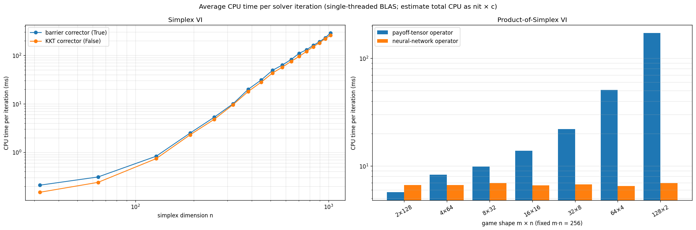

# Fixed-Point Bundle Method for Variational Inequalities and Game Equilibria

Reference implementation of the *fixed-point bundle* predictor–corrector path-following method for

- variational inequalities on the simplex, $\mathrm{VI}(F,\Delta_n)$, and
- variational inequalities on the product of simplices, $\mathrm{VI}(F,\Delta_n^m)$, which include the Nash equilibrium problem of finite normal-form games.

The method requires no monotonicity or other structural assumptions: it follows special central paths on a fiber bundle from an arbitrary starting point, detects and avoids singularities, and guarantees global linear convergence.

**Contents:** [Overview](#overview) · [Repository structure](#repository-structure) · [Installation](#installation) · [Quick start](#quick-start) · [Operator models](#operator-models) · [Solver API](#solver-api) · [Numerical experiments](#numerical-experiments) · [Cost per iteration](#cost-per-iteration) · [Data](#data) · [Citation](#citation) · [License](#license)

Python ≥ 3.9 · NumPy ≥ 2.0 · SciPy ≥ 1.10 · MIT License

## Overview

The repository accompanies two papers:

| #   | Paper                                                                                                                                                                                                                | Implementation                                    |
| --- | -------------------------------------------------------------------------------------------------------------------------------------------------------------------------------------------------------------------- | ------------------------------------------------- |
| 1   | *A path-following framework on fiber bundle for variational inequalities* — [arXiv:2606.00778](https://arxiv.org/abs/2606.00778), [Optimization Online](https://optimization-online.org/?p=34972)                    | `solvers/vi_numpy.py` (for $\mathrm{VI}(F,\Delta_n)$) |
| 2   | *The fixed-point bundle method over product-of-simplex domains arising from game equilibria* — [arXiv:2609.16158](https://arxiv.org/abs/2609.16158), [Optimization Online](https://optimization-online.org/?p=36751) | `solvers/game_numpy.py` (for $\mathrm{VI}(F,\Delta_n^m)$) |

It contains the solvers, the operator models used to generate random test instances, the experiment driver, the full per-instance logs behind the tables below, and per-iteration cost measurements.

## Repository structure

| Path                         | Description                                                                                                                                                                                                            |
| ---------------------------- | ---------------------------------------------------------------------------------------------------------------------------------------------------------------------------------------------------------------------- |
| `main.py`                    | Experiment driver: the two operator models (`NeuralNetworkOperator`, `PayoffTensorOperator`), the solver drivers `run_vi_instance` / `run_game_instance`, and the command-line interface.                              |
| `solvers/`                   | Solver package: `VI_simplex`, `VI_simplex_product`, and the internal root finder.                                                                                                                                    |
| `solvers/vi_numpy.py`        | Class `VI_simplex` — solver for $\mathrm{VI}(F,\Delta_n)$.                                                                                                                                                          |
| `solvers/game_numpy.py`      | Class `VI_simplex_product` — solver for $\mathrm{VI}(F,\Delta_n^m)$.                                                                                                                                                |
| `solvers/find_root_numpy.py` | Bit-identical reimplementation of `scipy.optimize.elementwise.find_root`, used because it is faster than calling the SciPy function. See the SciPy documentation for the algorithm. |
| `data/`                      | Per-instance experiment logs behind Tables 1 and 2; see [Data](#data).                                                                                                                                                 |
| `data/README.md`             | Layout, file naming and log format of the data folder.                                                                                                                                                                 |
| `docs/cpu_per_iteration.png` | Measured average CPU time per solver iteration; see [Cost per iteration](#cost-per-iteration).                                                                                                                         |
| `requirements.txt`           | Python dependencies.                                                                                                                                                                                                   |
| `LICENSE`                    | MIT license.                                                                                                                                                                                                           |
| `CITATION.cff`               | Citation metadata for the repository.                                                                                                                                                                                  |

## Installation

```bash
git clone https://github.com/shb20tsinghua/FiberBundle_VI.git
cd FiberBundle_VI

python -m venv .venv
.venv\Scripts\activate        # Windows
# source .venv/bin/activate   # Linux / macOS

pip install -r requirements.txt
```

Requirements:

- Python ≥ 3.9 (tested with Python 3.14)
- NumPy ≥ 2.0 (`np.vecdot`, `np.matvec` are used in `solvers/game_numpy.py`)
- SciPy ≥ 1.10 (`scipy.linalg.lu_factor`, `scipy.linalg.lu_solve`, `scipy.optimize.brentq`)

No GPU is needed; the solvers are pure NumPy/SciPy.

## Quick start

```bash
python main.py
```

solves the demo instance — a payoff-tensor game with `m = n = 16` and `R = 256`, seed `0`, barrier corrector — and prints one result line such as

```
|  0  |True   |  983  |9.761908e-06|1.570267e-05|7.528350e-10|  25   |
```

(the columns are `seed | success | nit | gap | barrier_sum | G_norm | avoid_n`; see [Solver API](#solver-api)).

From the command line:

```bash
# simplex VI: m = 1, network operator; hidden layers default to [m*n] = [64]
python main.py --dimension 1 64 --model nn --seed 3

# payoff-tensor game: 16 players, 16 actions; rank defaults to m*n = 256
python main.py --dimension 16 16 --model payoff --seed 0

# override the default hidden layers with two layers [256, 128]
python main.py --dimension 16 16 --model nn --hidden-layers "[256, 128]" --seed 0
```

`solvers/game_numpy.py` can handle all model types for arbitrary `m` and `n`, but when `m = 1`, `solvers/vi_numpy.py` can handle the problem as well and is faster, so we route `nn_F` with `m = 1` to `VI_simplex`.

The available options are:

| Option                     | Meaning                                                                            |
| -------------------------- | ---------------------------------------------------------------------------------- |
| `--dimension M N`          | dimensions `m n`; required                                                         |
| `--model {nn_F, payoff_F}` | operator model; required                                                           |
| `--seed N`                 | random seed of the instance (default `0`)                                          |
| `--hidden-layers LIST`     | bracketed list of hidden-layer widths, e.g. `"[8, 4]"` or `"[]"` (default `[m*n]`) |
| `--rank R`                 | CP rank of the payoff-tensor model (default `m*n`)                                 |
| `--kkt`                    | use the KKT corrector instead of the barrier corrector                             |
| `--threads N\|auto`        | number of BLAS/OpenMP threads (default `1`); `auto` keeps the library defaults     |
| `--verbose {0,1,2}`        | iteration-trace verbosity (default `0`)                                            |

`python main.py --help` prints the same list.

To call a solver directly on your own operator, implement a class with a single method
`value_Jaco(x) -> (F, JF)` returning the operator value and its Jacobian at `x`:

```python
import numpy as np
from solvers import VI_simplex


class QuadraticF:
    """F(sigma) = A sigma + b for a symmetric positive definite A."""

    def __init__(self, A, b):
        self.A, self.b = A, b

    def value_Jaco(self, sigma):
        return self.A @ sigma + self.b, self.A


n = 5
rng = np.random.default_rng(0)
A = rng.standard_normal((n, n))
A = A.T @ A + n * np.eye(n)
b = rng.standard_normal(n)

sigma_init = rng.dirichlet(np.ones(n))
sigma, info = VI_simplex(QuadraticF(A, b)).solve(
    sigma_init, gap_tol=1e-8, maxnit=50000, maxsubnit=10)

nit, gap, mu_sum, g_norm, avoid_n = info
print(sigma, gap)
```

## Operator models

`main.py` provides the two random operator models used in the experiments. Both expose the same
`value_Jaco(x) -> (F, JF)` interface expected by the solvers.

### Neural-network model

```python
NeuralNetworkOperator(seed, layer_widths, activation)
```

A fully connected network with widths `layer_widths = [dim, *hidden_layers, dim]` and activation
`0 = tanh`, `1 = sigmoid`, `2 = linear`. Weights use the Xavier normal distribution
$N(0, 2/(\text{input width} + \text{output width}))$ (standard deviation
$1/\sqrt{(\text{in}+\text{out})/2}$), which keeps the tanh activations out of saturation; biases are
drawn from $N(0, 10^{-4})$ (standard deviation `1e-2`). The model represents a general real-analytic
operator and can be used on either domain: `dim = n` for $\Delta_n$, `dim = m*n` for $\Delta_n^m$.

### Payoff-tensor model

```python
PayoffTensorOperator(seed, players, actions, rank)
```

The VI operator of a finite normal-form game with `m` players and `n` actions, represented by the
gradient of a low-rank CP (canonical polyadic) payoff function

$$f_i(\pi)=\sum_{r=1}^{R}\prod_{j=1}^{m}\left(U_{r,i,j}\,\pi_j\right),
\qquad
F_i(\pi)=\nabla_{\pi_i} f_i(\pi), \qquad \pi_i\in\Delta_n ,$$

reducing the storage from $n^m$ to $Rmn$.
The entries of $U\in\mathbb{R}^{R\times m\times n\times m}$ are drawn from $N(1, 1/m)$; `rank = m*n`
is the setting used in the experiments. This model is only defined on the product domain
$\Delta_n^m$.

## Solver API

Both solvers follow the same interface. For $\mathrm{VI}(F,\Delta_n)$ use

```python
from solvers import VI_simplex
sigma, info = VI_simplex(operator).solve(iter_init, gap_tol, ...)
```

and for $\mathrm{VI}(F,\Delta_n^m)$ use

```python
from solvers import VI_simplex_product
pi, info = VI_simplex_product(operator).solve(iter_init, gap_tol, ...)
```

### `solve(...)` parameters

| Parameter             | Default  | Meaning                                                                                                                                                                                                                                                                      |
| --------------------- | -------- | ---------------------------------------------------------------------------------------------------------------------------------------------------------------------------------------------------------------------------------------------------------------------------- |
| `iter_init`           | required | Starting point: array of shape `(n,)` in $\Delta_n$ for `VI_simplex`, or `(m, n)` in $\Delta_n^m$ for `VI_simplex_product`.                                                                                                                                                  |
| `gap_tol`             | required | Required precision. `VI_simplex` stops when $\mathrm{gap}(\sigma)=\sigma^\top F(\sigma)-\min_a F_a(\sigma)\le\texttt{gap\_tol}$; `VI_simplex_product` stops when $\mathrm{gap}_i(\pi)=\pi_i^\top F_i(\pi)-\min_a F_{i,a}(\pi)\le\texttt{gap\_tol}$ for **every** player $i$. |
| `efficient_corrector` | `True`   | Which regularised Newton corrector to use. `True`: corrector derived from the barrier problem (faster and recommended). `False`: corrector derived from the perturbed KKT conditions.                                                                                        |
| `maxnit`              | `50000`  | Maximum total number of predictor–corrector iterations.                                                                                                                                                                                                                      |
| `maxsubnit`           | `10`     | Maximum number of corrector subiterations per predictor step.                                                                                                                                                                                                                |
| `verbose`             | `0`      | `0`: silent; `1`: one line per completed corrector; `2`: one line per corrector subiteration. Only takes effect if `record_file` is not `None`.                                                                                                                              |
| `record_file`         | `None`   | Path of the iteration-trace log (`None` disables recording).                                                                                                                                                                                                                 |
| `print_preci`         | `6`      | Number of decimal places in the printed trace.                                                                                                                                                                                                                               |

### Return value

`solve` returns `(solution, info)`:

|            | `VI_simplex`                                       | `VI_simplex_product`                              |
| ---------- | -------------------------------------------------- | ------------------------------------------------- |
| `solution` | $\sigma\in\Delta_n$, or `None` if the solver fails | $\pi\in\Delta_n^m$, or `None` if the solver fails |
| `info[0]`  | `nit` — total iterations                           | `nit`                                             |
| `info[1]`  | final gap $\mathrm{gap}(\sigma)$                   | final $\max_i \mathrm{gap}_i(\pi)$                |
| `info[2]`  | `mu_sum` — final $\mathbf{1}^\top\mu$              | final $\max_i \mathbf{1}^\top\tau_i$              |
| `info[3]`  | `G_norm` — $\lVert G(\sigma,\mu)\rVert$            | `G_norm` — $\lVert G(\pi,\tau)\rVert$             |
| `info[4]`  | `avoid_n` — number of singularity-avoidance steps  | `avoid_n`                                         |

## Numerical experiments

The settings below are those of the two papers.

### $\mathrm{VI}(F,\Delta_n)$ — `solvers/vi_numpy.py`

- **Operator:** tanh network, Xavier normal initialization, architecture `[n, n, n]` with `n` from 2 to 1024, and `[256]*d` with depth `d` from 2 to 8.
- **Starting point:** uniformly random in $\Delta_n$.
- **Precision:** `gap_tol = 1e-5`.
- **Correctors:** both the KKT corrector and the barrier corrector.
- **Instances:** 200 per setting, 6400 in total. The algorithm converged on every instance.

**Table 1.** Statistics (mean / median) solving $\mathrm{VI}(F,\Delta_n)$.

| Architecture | `n` or `d` | KKT: iterations | KKT: avoidance | Barrier: iterations | Barrier: avoidance |
| ------------ | ---------- | --------------- | -------------- | ------------------- | ------------------ |
| `[n, n, n]`  | 2          | 280 / 291       | 0.1 / 0.0      | 294 / 309           | 0.1 / 0.0          |
| `[n, n, n]`  | 4          | 353 / 327       | 1.2 / 0.0      | 360 / 339           | 1.3 / 0.0          |
| `[n, n, n]`  | 8          | 386 / 334       | 2.8 / 0.0      | 377 / 338           | 2.0 / 0.0          |
| `[n, n, n]`  | 16         | 436 / 341       | 4.5 / 0.0      | 410 / 332           | 4.1 / 0.0          |
| `[n, n, n]`  | 32         | 554 / 359       | 10.7 / 0.0     | 511 / 335           | 10.8 / 0.0         |
| `[n, n, n]`  | 64         | 804 / 521       | 24.8 / 8.0     | 723 / 501           | 24.8 / 8.5         |
| `[n, n, n]`  | 128        | 1194 / 726      | 46.2 / 20.0    | 1009 / 656          | 43.6 / 20.5        |
| `[n, n, n]`  | 256        | 1062 / 648      | 40.4 / 18.5    | 954 / 598           | 41.1 / 17.0        |
| `[n, n, n]`  | 512        | 1062 / 634      | 40.3 / 17.5    | 927 / 579           | 39.8 / 17.5        |
| `[n, n, n]`  | 1024       | 948 / 553       | 35.0 / 10.0    | 892 / 452           | 38.3 / 8.5         |
| `[256]*d`    | 2          | 1650 / 981      | 72.9 / 34.5    | 1258 / 837          | 60.9 / 33.5        |
| `[256]*d`    | 3          | 1062 / 648      | 40.4 / 18.5    | 954 / 598           | 41.1 / 17.0        |
| `[256]*d`    | 4          | 902 / 571       | 31.1 / 12.0    | 870 / 512           | 35.5 / 11.5        |
| `[256]*d`    | 5          | 823 / 543       | 26.7 / 9.0     | 717 / 474           | 25.4 / 8.5         |
| `[256]*d`    | 6          | 685 / 442       | 19.1 / 5.0     | 605 / 406           | 18.2 / 4.5         |
| `[256]*d`    | 7          | 757 / 424       | 23.8 / 4.5     | 621 / 396           | 19.7 / 3.5         |
| `[256]*d`    | 8          | 717 / 422       | 21.0 / 3.5     | 584 / 376           | 16.8 / 3.0         |

For the tanh network with Xavier normal initialization, the function complexity actually *decreases*
as the depth increases, which is why the iteration count generally falls with `d`.

### $\mathrm{VI}(F,\Delta_n^m)$ — `solvers/game_numpy.py`

- **Operators:**
  - *Neural-network model:* tanh network with architecture `[mn, mn, mn]`, Xavier normal initialization.
  - *Payoff-tensor model:* low-rank CP payoff with `R = mn`, `U ~ N(1, 1/m)`.
- **Starting point:** uniformly random in $\Delta_n^m$.
- **Precision:** $\mathrm{gap}_i(\pi)\le 1\text{e-}5$ for every player.
- **Corrector:** barrier corrector only (`efficient_corrector=True`), which is faster in the experiments of Paper 1 (see Table 1).
- **Dimensions:** fixed player number `m = 8` with action number `n` from 2 to 32; fixed action number `n = 8` with player number `m` from 2 to 32; fixed total dimension `mn = 256` with `(m, n)` from `(2, 128)` to `(128, 2)`.
- **Instances:** 200 per setting, 5600 in total. The algorithm converged on every instance.

**Table 2.** Statistics (mean / median) solving $\mathrm{VI}(F,\Delta_n^m)$.

| `m`, `n` | NN: iterations | NN: avoidance | Payoff: iterations | Payoff: avoidance |
| -------- | -------------- | ------------- | ------------------ | ----------------- |
| 8, 2     | 369 / 350      | 0.8 / 0.0     | 360 / 353          | 0.2 / 0.0         |
| 8, 4     | 446 / 387      | 3.3 / 0.0     | 439 / 394          | 2.0 / 0.0         |
| 8, 8     | 618 / 517      | 10.2 / 5.0    | 548 / 442          | 5.3 / 0.0         |
| 8, 16    | 907 / 789      | 23.4 / 18.5   | 632 / 565          | 7.9 / 5.0         |
| 8, 32    | 2067 / 1344    | 75.0 / 44.0   | 823 / 702          | 14.7 / 10.0       |
| 2, 8     | 394 / 356      | 2.0 / 0.0     | 409 / 403          | 0.3 / 0.0         |
| 4, 8     | 435 / 375      | 3.4 / 0.0     | 454 / 412          | 2.0 / 0.0         |
| 8, 8     | 618 / 517      | 10.2 / 5.0    | 548 / 442          | 5.3 / 0.0         |
| 16, 8    | 1053 / 836     | 27.2 / 18.0   | 710 / 640          | 11.3 / 9.0        |
| 32, 8    | 2561 / 1823    | 85.4 / 58.5   | 1287 / 1133        | 31.0 / 25.0       |
| 2, 128   | 1203 / 825     | 48.6 / 30.0   | 532 / 477          | 2.5 / 0.0         |
| 4, 64    | 1616 / 1084    | 62.1 / 37.5   | 619 / 533          | 6.0 / 1.0         |
| 8, 32    | 2067 / 1344    | 75.0 / 44.0   | 823 / 702          | 14.7 / 10.0       |
| 16, 16   | 2128 / 1518    | 70.8 / 44.5   | 1054 / 929         | 23.3 / 19.0       |
| 32, 8    | 2561 / 1823    | 85.4 / 58.5   | 1287 / 1133        | 31.0 / 25.0       |
| 64, 4    | 2616 / 1790    | 85.8 / 53.5   | 1544 / 1265        | 40.9 / 31.0       |
| 128, 2   | 1142 / 955     | 30.7 / 23.0   | 942 / 754          | 20.1 / 12.5       |

Solving with the payoff operator is significantly easier than with the neural-network operator:
networks produce stronger nonlinearity and a more twisted singular manifold, so much more
singularity avoidance is needed.

## Cost per iteration

The cost of a run can be estimated as `CPU time ≈ nit × c`, where `c` is the average CPU time per
solver iteration. The figure below gives `c` for both problem families. The values are measured with
`time.process_time()` around `solve()` only (operator construction and the initial draw excluded),
one BLAS thread (the driver's default), `verbose=0`, and `gap_tol=1e-5`.



In the left panel (simplex VI with the neural-network operator), `c` grows smoothly with the
dimension `n` for both correctors; the barrier corrector is slightly more expensive because it solves
a scalar root per iteration. In the right panel (game VI with the barrier corrector), the total
dimension is fixed at `m*n = 256`, so the comparison isolates the shape: the payoff-tensor cost grows
strongly with `m`, because the Jacobian assembly cost grows with the number of player blocks, while
the neural-network operator — with architecture `[256, 256, 256]` for every shape in this test — stays
at about constant.

**Caveats.** `c` is hardware-dependent (reference machine: Intel Tiger Lake laptop, 8 logical cores,
Windows, NumPy 2.5/OpenBLAS, SciPy 1.18, Python 3.14); expect ±20–30 % on another machine. Use the
values as an order-of-magnitude guide, not as a benchmark.

## Data

`data/` contains the complete per-instance results behind Tables 1 and 2.

```text
data/
├── data_vi/                      # VI(F, Δ_n): 200 instances per file
│   ├── kkt_<n>.log               #   architecture [n, n, n], KKT corrector, n = 2 ... 1024
│   ├── barr_<n>.log              #   (same for the barrier corrector)
│   ├── kkt_256_d<d>.log          #   depth sweep [256]*d, d ∈ {2, 4, 5, 6, 7, 8}
│   └── barr_256_d<d>.log         #   (same for the barrier corrector)
└── data_game/                    # VI(F, Δ_n^m): 200 instances per file
    ├── nn_<m>_<n>.log            #   neural-network operator, architecture [m*n, m*n, m*n]
    └── payoff_<m>_<n>.log        #   payoff-tensor operator, R = m*n
```

Every per-configuration `.log` file has a header line followed by one row per instance:

```text
| 5  |True   |  187  |9.834558e-06|4.773111e-05|2.168071e-12|   0   |
```

| Column        | Meaning                                                                                                        |
| ------------- | -------------------------------------------------------------------------------------------------------------- |
| `seed`        | random seed of the instance                                                                                    |
| `success`     | `True` if the solver reached the requested gap tolerance                                                       |
| `nit`         | total iteration count                                                                                          |
| `gap`         | final gap value ($\mathrm{gap}(\sigma)$, or $\max_i\mathrm{gap}_i(\pi)$ for games)                             |
| `barrier_sum` | final barrier-parameter sum: $\mathbf{1}^\top\mu$ for `data_vi`, $\max_i\mathbf{1}^\top\tau_i$ for `data_game` |
| `G_norm`      | norm of the fixed-point bundle equation residual                                                               |
| `avoid_n`     | number of singularity-avoidance steps                                                                          |

The two tables report `int(mean(nit))`, `int(median(nit))`, and the mean and median of `avoid_n`
formatted to one decimal place. The logs contain 12,000 rows in total (6,400 simplex VI instances and
5,600 game instances), all with `success = True`.

### Reproducibility

- Every instance is fully determined by its random seed: the operator parameters and the starting
  point are generated from `np.random.seed(seed)`, and the singularity-avoidance step draws from the
  same seeded generator. Runs are therefore deterministic on a given platform and library version.
- A full run over all settings of the two tables means 12,000 solver calls; expect hours on a laptop.
  The demo `python main.py` takes well under a minute.

## Citation

If you use this code, please cite the corresponding papers:

```bibtex
@misc{paper1,
      title={A path-following framework on fiber bundle for variational inequalities},
      author={Hongbo Sun},
      year={2026},
      eprint={2606.00778},
      archivePrefix={arXiv},
      primaryClass={math.OC},
      url={https://arxiv.org/abs/2606.00778}
}

@misc{paper2,
      title={The fixed-point bundle method over product-of-simplex domains arising from game equilibria},
      author={Hongbo Sun},
      year={2026},
      eprint={2609.16158},
      archivePrefix={arXiv},
      primaryClass={math.OC},
      url={https://arxiv.org/abs/2609.16158}
}
```

## License

Released under the [MIT License](LICENSE).
